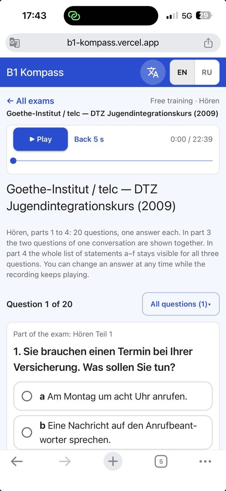
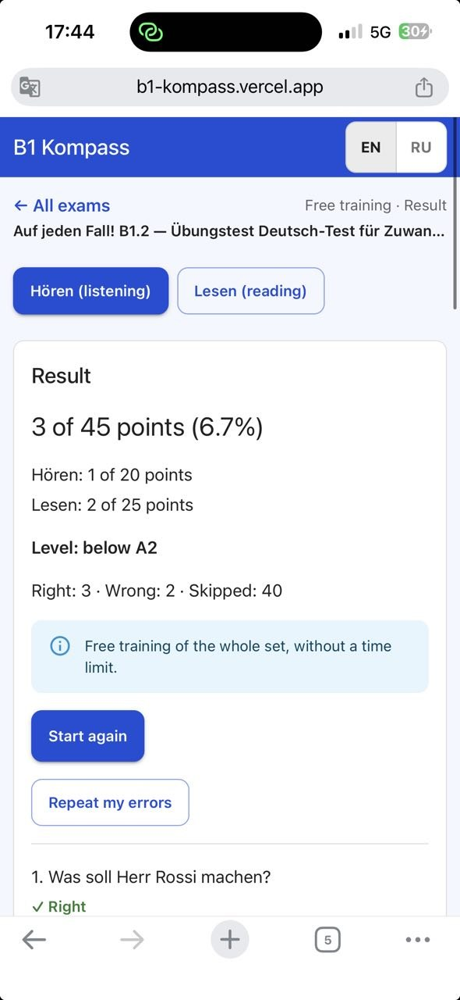
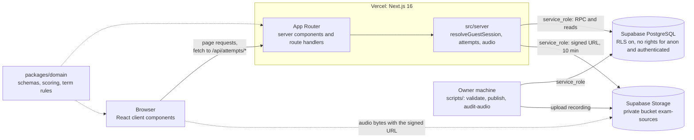

# B1 Kompass

**An online trainer for the German DTZ exam (A2–B1): Hören and Lesen, on a phone or a desktop, with no sign-up.**

Live app: **https://b1-kompass.vercel.app** (interface in English and Русский)

## The problem

People preparing for the DTZ usually practise with printed workbooks and a separate audio CD or file. They have to track the listening position by hand, check answers against a key at the back of the book and add up the score themselves. B1 Kompass puts a complete practice exam in the browser: one continuous recording, the reading texts next to their tasks, an answer check done by the server and a review of every task afterwards.

It is a practice tool, not a certificate. It covers Hören and Lesen only; Schreiben and Sprechen are not part of it.

## Screenshots

Real mobile screenshots of the working guest trainer. Click either image for the full-size view.

<p align="center">
  <a href="docs/screenshots/hoeren-mobile.jpg"></a>
  <a href="docs/screenshots/results-mobile.jpg"></a>
</p>

<p align="center"><em>Hören (listening practice) · Results and review</em></p>

## What you can do

- **Start in one click.** "Continue as guest" needs no e-mail or password. A guest session lasts 30 days from the first visit and is never extended.
- **Pick an exam from the library.** Each card is a full DTZ set: 20 Hören and 25 Lesen tasks, 45 in total. The card shows your own *Continue* and your latest result.
- **Choose how to practise:** free practice of the whole exam or one block, a timed block (Hören or Lesen), a full exam with a server-side clock, or a repeat of your own mistakes.
- **Listen to the original recording.** One continuous recording per exam, with play/pause, "back 5 s" and seeking in the practice modes. In the full exam the recording runs without pause or seeking, as in the real test.
- **Read with the task beside the text.** On a narrow screen a *Text / Task* switch replaces the two columns.
- **Get a server-checked result:** points out of 20 (Hören), 25 (Lesen) and 45, the percentage, the DTZ level (below A2 / A2 / B1) and a review of every task.
- **Look up one word** in a German text (a translation card in the interface language).
- **Carry on after a refresh.** Answers, the current block and task, the place in the text and the audio position are restored.
- **Use it with a keyboard and at larger text sizes.** German material is never translated; the interface language belongs to the guest session.

## Stack

| Layer | Technology |
| --- | --- |
| Web app | Next.js 16 (App Router), React 19, TypeScript (strict), MUI 7, next-intl |
| Shared rules | `@b1k/domain`: pure TypeScript with Zod schemas, no I/O |
| Data and files | Supabase: PostgreSQL (RLS, SQL functions) and private Storage |
| Hosting | Vercel for the app, a separate hosted Supabase project for data |
| Quality | Vitest, Playwright against an isolated local Supabase, ESLint, Prettier, GitHub Actions |
| Process | A pinned `dark-factory` toolkit that gates edits, commits and PR checks |

## Engineering highlights

- **The answer key never leaves the server before review.** The published exam content has no key field in its schema; the key lives in its own table that no browser-facing role can read.
- **Published material is immutable.** A corrected exam becomes a new version, and an attempt stays pinned to the version it started on, so a fix cannot change the score of a running attempt.
- **The database is a second line of defence.** Every server operation resolves the guest session itself, and the SQL functions check the session and the attempt owner again. `anon` and `authenticated` have no rights on tables or functions.
- **Time belongs to the server.** Deadlines for timed blocks and the full exam are fixed on the server; the browser clock is only a display.
- **One audio owner per exam.** A single `<audio>` element plays the recording of a full exam; moving between tasks, blocks and the library never leaves a second player running.
- **A trusted publishing path with an SQL guard.** The owner publishes exams with a command-line tool; a database function refuses a wrong exam identity, a changed format or an accidental rename.

## Project status

The statuses below are kept apart on purpose. "Implemented" does not mean "accepted".

| Question | Answer | Basis |
| --- | --- | --- |
| Implemented in code | M1 guest trainer, M2 modes and timers, word lookup, M3 library with the owner CLI | Merged PRs; M3 code tasks #74–#82 and #84–#86 are closed |
| Checked by CI | The `Quality` job (typecheck, lint, unit tests, build, E2E on an isolated Supabase) passed on `main` at `26b00eb` | [CI workflow](.github/workflows/ci.yml) |
| Deployed | `26b00eb` was released to Production on 2026-11-17 | GitHub Deployment `production`, Release Production run 12 |
| Exams in Production | **Three exams, owner-reported on 2026-11-17.** Not independently verified from the repository | Owner statement; see [deployment status](docs/deployment.md#фактический-статус-публикации) |
| Manual acceptance | **Not done.** Real-device testing, source and key verification of the exams and the M3 acceptance report are open | Issues [#83](https://github.com/strakhovdenya/b1-kompass/issues/83) and [#88](https://github.com/strakhovdenya/b1-kompass/issues/88) are open; M1 and M2 reports: [m1-acceptance.md](docs/m1-acceptance.md), [m2-acceptance.md](docs/m2-acceptance.md) |

Not built yet: a web admin interface, PDF import, audio alignment for Hören, personal accounts, analytics, speaking modules. See [docs/roadmap.md](docs/roadmap.md).

---

# Architecture and engineering notes

The rest of this document is for engineers. It states what the code does, why it was built that way and where the limits are. Details live in `docs/`; the project documentation is written in Russian.

## System overview



The browser never talks to Supabase with credentials. It sends requests to Next.js; only `apps/web/src/server` and `scripts/` hold the privileged client. The audio bytes are the one exception on the data path: the server hands out a short-lived signed URL and the browser reads the file from Storage directly, so the app does not proxy large files.

## Monorepo and module boundaries

```text
apps/web/          Next.js app: routes, client features, trusted server code (src/server)
packages/domain/   pure rules and contracts: material schema, scoring, attempt lifecycle, guest term, locales
scripts/           trusted owner tools (publish, validate, audit, timing profile, local E2E stack)
supabase/          migrations of the isolated Supabase project
docs/              PRDs, plans, architecture, security, deployment, acceptance reports
```

Dependency direction is one-way: `features/*` (client UI) depends on `@b1k/domain` and next-intl only; `src/server` depends on the domain package; the domain package depends on nothing in the app. ESLint fails the build when UI code imports `src/server/**` or the Supabase SDK, so the rule that keeps the secret key out of the browser is checked by a tool, not by convention. A build test additionally scans `.next` output for owner-CLI code and secrets (see [docs/security.md](docs/security.md), section "Матрица M3").

Server functions take their dependencies (`ServerDeps`: database client and clock) as an argument. Only `src/server/next/**` reads cookies and environment variables. That is why tests can call the real functions with a fixed clock instead of mocking results.

## Next.js App Router: client and server

- Pages are server components and are dynamic; every response carries `Cache-Control: private, no-store` ([next.config.ts](apps/web/next.config.ts)) so personal answers never enter a shared cache.
- Interactive screens (`src/features/**`) are client components. They receive server actions or call route handlers as props or through fetch helpers.
- Saves, submission, cancel and status are independent HTTP commands under `app/api/attempts/*` (start, answer, progress, submit, cancel, status, audio). They do not wait in the queue of Next.js server actions, so a slow save cannot block a submission. Each command checks the exact `Origin` of the request (CSRF) and rejects unknown fields with a strict input schema.
- Routes: `/` (entry), `/exams` (library), `/practice/[examSlug]` (mode selection), `/practice/[examSlug]/attempts/[attemptId]` (Hören) and `.../lesen`. The older `/practice` and `/practice/lesen` only redirect.

## Supabase: PostgreSQL, Storage, RLS and RPC

The data model has three groups: material (`exams`, `exam_versions`, `answer_keys`, `exam_version_audio`), guest state (`guest_sessions`, `attempts`, `attempt_runs`, `attempt_answers`, `attempt_results`, events) and a dictionary cache.

- RLS is enabled everywhere, and `anon` and `authenticated` have no privileges on tables or functions. `service_role` can read and write the `public` tables directly (`select, insert, update, delete`) and execute the runtime functions; triggers still block changes to published versions, keys and closed attempts, even for this role. This is the basis of the residual risk described below and in [docs/security.md](docs/security.md).
- State-changing logic lives in SQL functions (`m2_start_attempt`, `m2_save_answer`, `m2_accept_submission`, `m2_finalize_attempt`, `publish_exam_version` and others). They take row locks, read the database clock and enforce lifecycle rules with triggers that also apply to `service_role`. Cores that accept an explicit time live in a schema (`m2_private`) with no API role granted usage, so no caller can pass a fake time in production.
- The recording is an object in the private bucket `exam-sources` at `audio/<sha256>.<ext>`. There are no policies on `storage.objects`, so only the server can read, list or upload.

**Why this shape:** the web server is trusted but not omnipotent. Putting the rules next to the data means a bug in a route handler still meets a database that refuses an expired session, a foreign attempt or a changed result. The cost is that the SQL surface is large and migrations are part of every feature. Full matrix: [docs/security.md](docs/security.md).

## Guest model without registration

- "Continue as guest" inserts one `guest_sessions` row. The row stores only a SHA-256 hash of a random 32-byte token; the token itself exists only in an httpOnly cookie (`b1k_guest`, SameSite=Lax, Secure in production). No Supabase Auth user is created, and sign-up is disabled in the cloud project.
- The term is fixed at `created_at + 720 hours` and is never extended; `now >= expires_at` is rejected, including by SQL functions.
- Session creation is rate-limited site-wide inside the database call (`create_guest_session`), so the limit cannot be raced.
- The interface language is stored on the session, and a new guest always starts in English.

**Trade-off:** a guest is shared access of one browser, not a person. A different browser or the end of the 30 days starts a new session with no history. Accounts are a separate future PRD ([ARC-04](docs/architecture-evolution.md)).

## Ownership checks and IDOR protection

`resolveGuestSession` is the single credential check. Every server operation calls it, and the SQL functions re-check session, expiry and attempt owner themselves. Client-sent owner, role, score or status fields are rejected by strict schemas.

For a foreign attempt id the answer is the same `404` as for a missing one, for pages, commands and audio; the review function answers `attempt-not-found`. The M3 security matrix tests this with four concurrent guests on two exams: foreign attempts, a version id from another exam, an expired or replaced guest, CSRF with a set of hostile `Origin` variants, direct Data API and Storage access with `anon` and `authenticated` tokens, and leaks through the catalog and caches. Every refusal is followed by a re-read of the whole database rows to prove nothing changed ([#85](docs/security.md)). These tests cover the listed scenarios; they are not a claim that the application is "secure in general".

## Exams and immutable versions

| Concept | Storage | Rule |
| --- | --- | --- |
| Exam | `exams` (slug, title, format) | Identity changes only through the guarded publish function |
| Version | `exam_versions.content` | Public projection (tasks, options, sources); triggers forbid `update` and `delete` |
| Key | `answer_keys` | Separate table; no browser-facing role reads it |
| Recording | `exam_version_audio` + Storage object | Immutable per version; bytes verified by SHA-256 |
| Attempt | `attempts` → one `exam_version_id` | Pinned at start; a new attempt takes the latest version |

The key comes from the printed source, never from a model. The catalog (`/exams`) reads only public columns and the latest version of each exam.

## Isolation of attempts, answers, results and audio

An attempt belongs to one guest session and one exam version. Answers are one row per task with a revision number; a late answer to a closed attempt is refused by a trigger. A result is one row per attempt, computed by the server from the frozen task snapshot and the private key, and the database checks it against the same snapshot. Repeating a completion returns the stored result instead of creating a second one.

Audio is served through the same ownership chain: guest session → attempt belongs to the session → track belongs to the attempt's version → phase gate of the full exam → signed URL. The Lesen material of a full exam is withheld until Lesen starts. A signed URL that has been issued cannot be revoked until it expires (600 s for practice; the end of Hören plus 300 s for a full exam).

## Server-side deadlines and the attempt lifecycle

Attempts are `active`, `completed` or `cancelled`. A start is an explicit command with a command id, so a repeated request returns the same attempt, and an active slot exists per (session, exam). Timed blocks and the full exam store absolute deadlines in `attempt_runs`; the browser clock only renders the countdown. When a deadline has passed, a reconcile function closes the run on the next read or write and only answers saved before the deadline count. Timed modes are available for an exam version only after the owner confirms its timing profile with a fingerprint of that version.

**Trade-off:** server-owned time makes the countdown consistent across tabs and devices, but a very slow network can lose the last answers of a timed block; the UI shows the save state to make that visible.

## Recovery after a page refresh

The server stores the progress of an attempt (current block, task, place in the text, audio position) and the answers. The client `useAttemptProgress` and answer store show "Saved" only after the server confirmed the latest choice; a failed save keeps the choice on screen with a retry. After a reload the player is only repositioned and never starts playing by itself.

## One active audio player

The recording belongs to Hören. For the full exam, `ExamAudioSession` (mounted in `app/practice/[examSlug]/layout.tsx` and keyed by the exam slug) owns the one `<audio>` element: moving between mode selection, Hören and Lesen of the same exam keeps the element and its position, and the audio position is computed from the server time. Leaving to the library or another exam unmounts the owner, pauses the recording and drops its source, so system media keys cannot resume exam A while exam B is open. Free practice and timed blocks use `AudioPlayer`, which sits outside the task navigation, so moving between tasks does not recreate it; the position is kept when leaving to the library ([#108](https://github.com/strakhovdenya/b1-kompass/issues/108)). Browser behaviour on real phones (system media buttons, locking, background) has not been verified manually.

## Trusted owner CLI and publication control

There is no web upload. The owner prepares a private manifest and recording in `private/` (ignored by Git) and runs:

| Command | What it does |
| --- | --- |
| `npm run exam:validate -- <manifest>` | Checks form and integrity offline; no network, no secrets, no secrets in the report |
| `npm run exam:publish -- <manifest> --new-exam` or `--new-version` | Re-validates, preflights, uploads the recording, calls `publish_exam_version` |
| `npm run exam:audit-audio` | Read-only listing of recording objects that no version references |

The guard is in SQL, not only in TypeScript: it serialises publications of one slug with a row lock and refuses `exam_exists`, `exam_not_found`, `exam_format_mismatch` and `exam_title_mismatch`. An identical package published with `--new-version` returns the existing version, so that retry is safe; a repeated `--new-exam` for an existing slug is refused with `exam_exists`. Storage and PostgreSQL share no transaction; an object left over after a failed publish is harmless and recoverable, and an existing object is never trusted by name but verified by SHA-256. The code check proves form, not truth: matching the 45 keys and the recording against the printed source is a manual owner step. Runbook: [docs/deployment.md](docs/deployment.md) (single authoritative owner procedure).

## Decisions and trade-offs

| Decision | Reason | Cost or risk |
| --- | --- | --- |
| Rules in SQL functions plus a server layer | A route-handler bug still meets a refusing database | More migrations and SQL tests per feature |
| Guest sessions, no accounts in M1–M3 | Lowest barrier for a practice tool | No cross-device history; term is 30 days |
| Immutable versions | Scores and review cannot change under a running attempt | Every correction is a new version |
| Owner CLI instead of an admin UI | No new privileged web surface while there is one owner | Publishing needs a computer and a manual source check |
| `publish_exam_version` is granted to `service_role` | One privileged role already exists for the server | **The web runtime holds the same role that can publish.** A separate owner database role is a future measure ([docs/security.md](docs/security.md)) |
| Single file audio source, one recording per exam | Simple, verifiable, matches the DTZ recording | No tracks or intervals; Hören alignment is deferred (ARC-01) |
| Free tiers of Supabase and Vercel | Cost | A Free Supabase project pauses after a week of inactivity; quotas apply |

## Verification model and its limits

| Layer | What it covers |
| --- | --- |
| Domain unit tests (Vitest) | Material schema, scoring, assignment and lifecycle rules |
| Component tests | Rendered client screens (`react-dom/server`) |
| Playwright and access tests | Real server against an isolated local Supabase: lifecycle, versions, repeat, deadlines, the M3 security matrix, the build-leak scan |
| CI `Quality` | Typecheck, lint, unit tests, build, Supabase start, E2E; the required check for a PR |

Local E2E runs only on the persistent stack `b1-kompass-e2e` through `scripts/e2e` with a lock and four target proofs; it never touches the development or Production database. Limits: the tests run on a local database and a local production build, not on the cloud project; they do not prove content correctness of a real exam, behaviour on real phones (autoplay, locking, background, network loss) or the cloud rights of Storage. Those checks stay manual and are tracked as open ([#83](https://github.com/strakhovdenya/b1-kompass/issues/83), [#88](https://github.com/strakhovdenya/b1-kompass/issues/88)).

## Deployment and operations

- The app is deployed to Vercel (Node 24) from a manual `Release Production` workflow with a preflight gate, a staged deployment with smoke checks, an owner approval step, migration history checks, `db push` and a promote of the staged build; each run leaves a GitHub Deployment record. Details: [docs/deployment.md](docs/deployment.md).
- Local start: `npm ci`, `npm run db:start`, then the app from `apps/web` with `.env.local` (template `.env.example`). Commands for typecheck, lint, tests, build and the E2E stack are in [CLAUDE.md](CLAUDE.md).
- Secrets (`SUPABASE_SECRET_KEY`, answer keys) are never committed or logged; `private/` and `.env*` are ignored.
- Known operational limits: the Free Supabase project can pause; a Production deployment is a record of a workflow run, not proof of a manual acceptance.

## Future development: ARC-01 to ARC-06

[docs/architecture-evolution.md](docs/architecture-evolution.md) keeps the architectural prerequisites for future work. State after M3:

| ARC | Topic | After M3 |
| --- | --- | --- |
| ARC-01 | Media source and player | Deferred: file source only; Hören alignment needs tracks with intervals and a position with a track id |
| ARC-02 | Library and attempt address | Closed for M3: catalog, entry through the library, exam context, explicit start |
| ARC-03 | Material format version | Deferred: no `contentSchemaVersion` yet; needed before PDF import or new exercise types |
| ARC-04 | Participant and owner | Deferred: guests only, no accounts or admin role; owner acts through scripts |
| ARC-05 | Module size | Still applies: `TrainingShell` and the answer-saving module stay large and are split when a PRD needs it |
| ARC-06 | Documentation as context | Still applies: every PRD, plan and Issue re-reads code and these documents |

## Documentation map

| Document | Content |
| --- | --- |
| [docs/project-overview.md](docs/project-overview.md) | Product scope and current state |
| [docs/architecture.md](docs/architecture.md) | Modules, material and versions, guest session, attempts, audio, scoring |
| [docs/architecture-evolution.md](docs/architecture-evolution.md) | ARC-01 to ARC-06 |
| [docs/security.md](docs/security.md) | Access matrix, RLS, grants, Storage, residual risks |
| [docs/deployment.md](docs/deployment.md) | Stack, environment, CI, release, owner runbook |
| [docs/training.md](docs/training.md), [docs/scoring.md](docs/scoring.md) | Training modes and DTZ scoring |
| [docs/pilot-material.md](docs/pilot-material.md) | Owner manifest v1 and exam material |
| [docs/roadmap.md](docs/roadmap.md) | Future work |
| [docs/prd/](docs/prd), [docs/plans/](docs/plans) | PRDs and plans for M1, M2 and M3 |
| [docs/m1-acceptance.md](docs/m1-acceptance.md), [docs/m2-acceptance.md](docs/m2-acceptance.md) | Acceptance reports (the M3 report is [#88](https://github.com/strakhovdenya/b1-kompass/issues/88), open) |
| [CLAUDE.md](CLAUDE.md), [apps/web/CLAUDE.md](apps/web/CLAUDE.md) | Invariants and rules for the repository and the web app |
